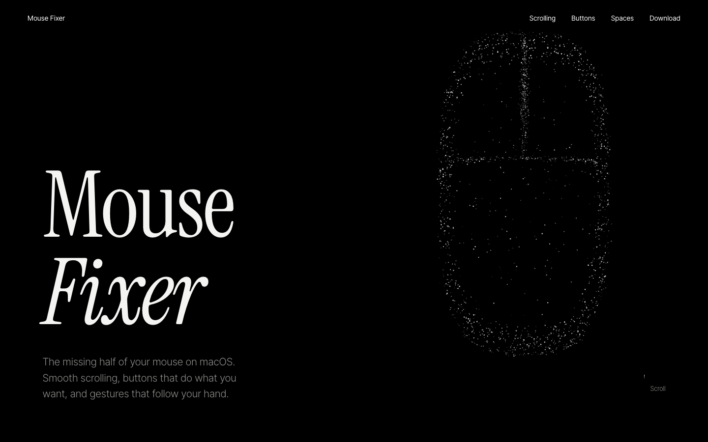

<div align="center">

# Mouse Fixer

### Free mouse fixes for macOS

**[→ Download it free at mouse-fixer-mac.netlify.app](https://mouse-fixer-mac.netlify.app)**

[](https://mouse-fixer-mac.netlify.app)
[](https://mouse-fixer-mac.netlify.app)

<a href="https://mouse-fixer-mac.netlify.app"></a>

</div>

---

## Get the app

1. Go to **<https://mouse-fixer-mac.netlify.app>** and press **Download free for Mac** (or take `MouseFixer.zip` from the [latest release](../../releases/latest)).
2. Unzip, drag **Mouse Fixer.app** to Applications.
3. Right-click it, choose **Open**. The build is signed with a personal certificate, not an Apple Developer ID, so macOS asks once.
4. Allow it in **System Settings → Privacy & Security → Accessibility**.

Free. No account, no subscription.

## What it does

- **Smooth scrolling** with momentum, three speeds, reverse direction, faster on quick notches.
- **Remappable buttons**: click, double and triple click, hold, drag, and chords with a second button held.
- **Spaces drag**: hold a button and drag sideways, your Spaces follow the mouse live, one Space at a time or as far as you drag. Drag up for Mission Control.
- **Per-app profiles**, picked by the app under the pointer or the frontmost app.
- **Scroll modifiers**: hold a key to scroll sideways, zoom, rotate, fast or precise.
- **Pointer speed and acceleration** for the mouse only.
- **Gestures** from a button: smart zoom, pinch, rotate, three-finger swipes (some are experimental).
- **15 languages**, a menu bar app, and an optional background helper that starts at login.

## Build from source

Needs macOS 13+ and the Swift toolchain.

```sh
./build.sh
```

The script compiles `main.swift`, builds the icon, copies translations and signs the app with a local certificate named `Mouse Fixer Dev`. Create one in Keychain Access (Certificate Assistant → Create a Certificate → Code Signing) or edit the identity in `build.sh`.

## Layout

| Path | What |
|---|---|
| `main.swift` | the whole app |
| `build.sh` | build and sign |
| `l10n/` | translation generators |
| `icon/` | icon generator |
| `website/` | the site on Netlify |
| `test/` | small test programs |

Not affiliated with any other mouse utility. This is an independent app.
